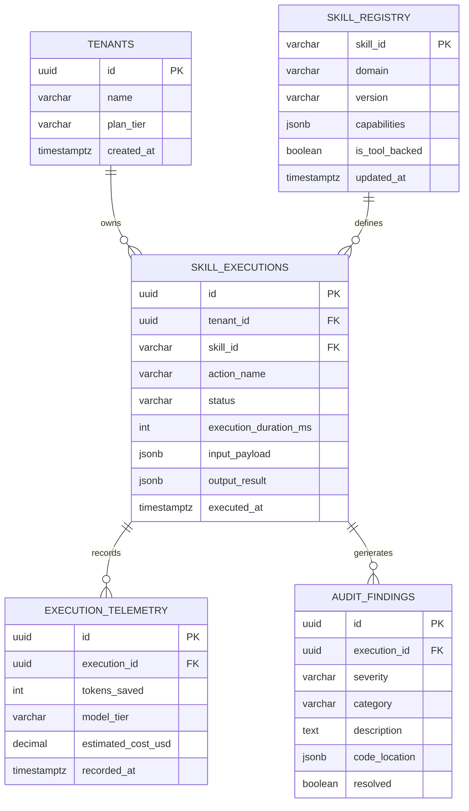

# 🗄️ Entity Relationship Diagram & Schema Spec: Skill Execution Registry (ERD)
**Standard**: PostgreSQL 16+ DDL | Multi-tenant RLS | Strict Invariants  
**System**: `vibes-plug` Skill Execution & Telemetry Store  

---

## 1. Visual Entity Relationship Model



---

## 2. Production PostgreSQL DDL with Foreign Keys & RLS

```sql
-- Enable necessary extensions
CREATE EXTENSION IF NOT EXISTS "uuid-ossp";
CREATE EXTENSION IF NOT EXISTS "pgcrypto";

-- 1. Tenants Table
CREATE TABLE IF NOT EXISTS tenants (
    id UUID PRIMARY KEY DEFAULT gen_random_uuid(),
    name VARCHAR(255) NOT NULL,
    plan_tier VARCHAR(64) NOT NULL DEFAULT 'standard',
    created_at TIMESTAMPTZ NOT NULL DEFAULT NOW(),
    updated_at TIMESTAMPTZ NOT NULL DEFAULT NOW()
);

-- 2. Skill Registry Table (Canonical Skill & Tool Definitions)
CREATE TABLE IF NOT EXISTS skill_registry (
    skill_id VARCHAR(128) PRIMARY KEY,
    domain VARCHAR(64) NOT NULL,
    version VARCHAR(32) NOT NULL DEFAULT '4.5.0',
    capabilities JSONB NOT NULL DEFAULT '[]'::jsonb,
    is_tool_backed BOOLEAN NOT NULL DEFAULT true,
    created_at TIMESTAMPTZ NOT NULL DEFAULT NOW(),
    updated_at TIMESTAMPTZ NOT NULL DEFAULT NOW()
);

CREATE INDEX idx_skill_registry_domain ON skill_registry(domain);

-- 3. Skill Executions Table
CREATE TABLE IF NOT EXISTS skill_executions (
    id UUID PRIMARY KEY DEFAULT gen_random_uuid(),
    tenant_id UUID NOT NULL REFERENCES tenants(id) ON DELETE CASCADE,
    skill_id VARCHAR(128) NOT NULL REFERENCES skill_registry(skill_id) ON DELETE RESTRICT,
    action_name VARCHAR(128) NOT NULL,
    status VARCHAR(32) NOT NULL DEFAULT 'pending', -- 'pending', 'completed', 'failed'
    execution_duration_ms INT NOT NULL DEFAULT 0,
    input_payload JSONB NOT NULL DEFAULT '{}'::jsonb,
    output_result JSONB NOT NULL DEFAULT '{}'::jsonb,
    executed_at TIMESTAMPTZ NOT NULL DEFAULT NOW()
);

CREATE INDEX idx_skill_executions_tenant ON skill_executions(tenant_id);
CREATE INDEX idx_skill_executions_skill ON skill_executions(skill_id);
CREATE INDEX idx_skill_executions_executed_at ON skill_executions(executed_at DESC);

-- 4. Execution Telemetry (FinOps & Token Optimization Tracking)
CREATE TABLE IF NOT EXISTS execution_telemetry (
    id UUID PRIMARY KEY DEFAULT gen_random_uuid(),
    execution_id UUID NOT NULL REFERENCES skill_executions(id) ON DELETE CASCADE,
    tokens_saved INT NOT NULL DEFAULT 0,
    model_tier VARCHAR(64) NOT NULL DEFAULT 'medium',
    estimated_cost_usd NUMERIC(10, 6) NOT NULL DEFAULT 0.000000,
    recorded_at TIMESTAMPTZ NOT NULL DEFAULT NOW()
);

CREATE INDEX idx_telemetry_execution ON execution_telemetry(execution_id);

-- 5. Audit Findings Table (Violations, Anti-Slop, Security Findings)
CREATE TABLE IF NOT EXISTS audit_findings (
    id UUID PRIMARY KEY DEFAULT gen_random_uuid(),
    execution_id UUID NOT NULL REFERENCES skill_executions(id) ON DELETE CASCADE,
    severity VARCHAR(32) NOT NULL DEFAULT 'medium', -- 'low', 'medium', 'high', 'critical'
    category VARCHAR(64) NOT NULL, -- 'anti-slop', 'rls-missing', 'api-drift', 'type-safety'
    description TEXT NOT NULL,
    code_location JSONB DEFAULT '{}'::jsonb,
    resolved BOOLEAN NOT NULL DEFAULT false,
    created_at TIMESTAMPTZ NOT NULL DEFAULT NOW()
);

CREATE INDEX idx_audit_findings_execution ON audit_findings(execution_id);
CREATE INDEX idx_audit_findings_severity ON audit_findings(severity);

-- ============================================================================
-- ROW LEVEL SECURITY (RLS) POLICIES
-- ============================================================================

ALTER TABLE tenants ENABLE ROW LEVEL SECURITY;
ALTER TABLE skill_executions ENABLE ROW LEVEL SECURITY;
ALTER TABLE execution_telemetry ENABLE ROW LEVEL SECURITY;
ALTER TABLE audit_findings ENABLE ROW LEVEL SECURITY;

-- Tenant Isolation Policies
CREATE POLICY tenant_isolation_tenants ON tenants
    FOR ALL
    USING (id = NULLIF(current_setting('app.current_tenant_id', true), '')::UUID);

CREATE POLICY tenant_isolation_executions ON skill_executions
    FOR ALL
    USING (tenant_id = NULLIF(current_setting('app.current_tenant_id', true), '')::UUID);

CREATE POLICY tenant_isolation_telemetry ON execution_telemetry
    FOR ALL
    USING (
        execution_id IN (
            SELECT id FROM skill_executions 
            WHERE tenant_id = NULLIF(current_setting('app.current_tenant_id', true), '')::UUID
        )
    );

CREATE POLICY tenant_isolation_findings ON audit_findings
    FOR ALL
    USING (
        execution_id IN (
            SELECT id FROM skill_executions 
            WHERE tenant_id = NULLIF(current_setting('app.current_tenant_id', true), '')::UUID
        )
    );
```
