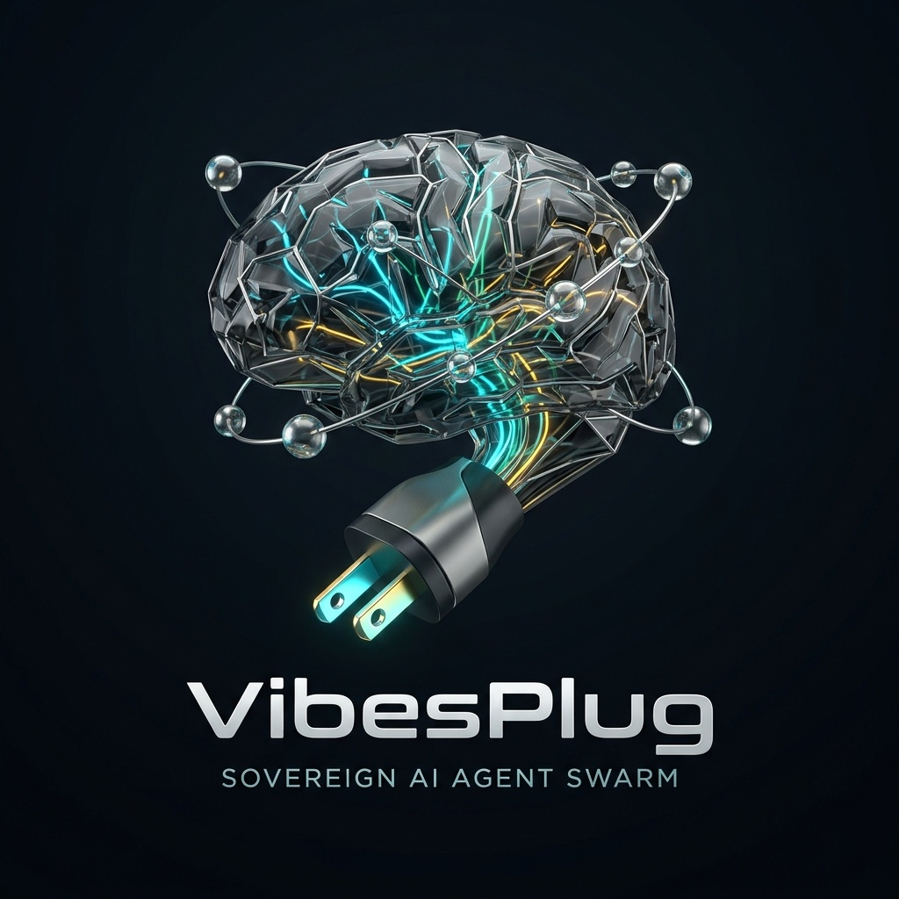
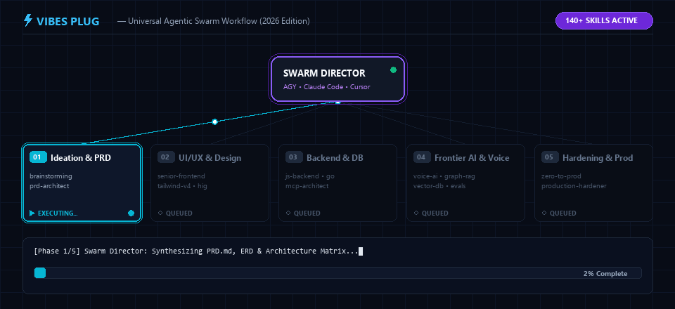

<div align="center">
  

# ⚡ VibesPlug Pro v4.4.2: 171-Skill AI Agent Swarm Architecture

**Turn any IDE into an autonomous 171-agent software development studio.**  
*Zero AI Slop • Sovereign Anti-Slop Directive • Zero Tech Debt • Pure Production Velocity*

<sub>💠 **3D Emblem Philosophy**: **Titanium Neural Plug** (Universal 6-IDE & MCP Connector) • **Obsidian Crystalline Brain** (Deterministic P1–P6 Reasoning) • **8 Orbital Spheres** (8 Specialist Subagents & 171 Domain Skills)</sub>

<p align="center">
  <a href="https://vibes-plug.vercel.app/"></a>
  <a href="https://github.com/roedyrustam/vibes-plug/stargazers"></a>
  <a href="https://github.com/roedyrustam/vibes-plug/network/members"></a>
  <a href="https://www.npmjs.com/package/vibes-plug"></a>
  <a href="https://www.npmjs.com/package/vibes-plug"></a>
  <a href="https://github.com/roedyrustam/vibes-plug/blob/master/LICENSE"></a>
  <a href="https://twitter.com/intent/tweet?text=Turn%20any%20IDE%20into%20a%20171-agent%20autonomous%20software%20studio%20with%20VibesPlug!%20%F0%9F%9A%80%20https%3A%2F%2Fgithub.com%2Froedyrustam%2Fvibes-plug%20%23VibeCoding%20%23AIAgents"></a>
</p>

<p align="center">
  <a href="https://github.com/roedyrustam/vibes-plug">⭐ <b>Star this repo</b></a> to support the project & help it trend!
</p>

[🇬🇧 English](#english) | [🇮🇩 Bahasa Indonesia](#bahasa-indonesia) | [🇨🇳 中文 (Mandarin)](#mandarin) | [🇩🇪 Deutsch (German)](#german) | [🇯🇵 日本語 (Japanese)](#japanese) | [📈 Star History](#star-history)
</div>

---

### 🎬 Swarm Director in Action

<div align="center">
  
</div>

<br />

```bash
# ⚡ Instant 1-Command Scaffold (NPM or Direct from GitHub)
npx vibes-plug init

# Or run directly from GitHub without installing:
npx github:roedyrustam/vibes-plug --all
```

---

## 💥 Why VibesPlug? (The Paradigm Shift)

| Metric / Capability | Vanilla Vibe Coding (Prompts) | Static IDE Rules (.cursorrules) | ⚡ VibesPlug Pro (Swarm) |
| :--- | :--- | :--- | :--- |
| **Agent Coordination** | ❌ 1 confused LLM doing everything | ⚠️ Static rules without orchestration | 🤖 **Swarm Director & 171 Specialists** |
| **Full-Stack Lifecycle** | ❌ Fragmented & prone to regressions | ⚠️ Ad-hoc guidance | 🚀 **Autonomous 8-Phase Zero-To-Prod** |
| **Tech Stack** | ⚠️ Often outputs legacy 2022 patterns | ⚠️ Stale prompts | ⚡ **React 19, Next 15, Tailwind v4, Bun 1.2+** |
| **Code Gardening & QA** | ❌ Hallucinated dead code & slop | ❌ No automated debt check | 🧹 **Zero-Tech-Debt Auditor & Red Teaming** |
| **Sovereign Anti-Slop** | ❌ Lazy stubs, placeholder stubs, & fluff | ⚠️ Untested static prompts | 🛡️ **Zero-Tolerance Anti-Slop Engine & Scanner** |
| **Payment & Micro-Economy** | ❌ Incomplete integrations | ⚠️ Basic docs | 💳 **DOKU Checkout, SNAP BI, Stripe, M2M Agent Wallets** |
| **Superintelligence Substrate**| ❌ None | ❌ None | 🧠 **P1–P5 Engines (KV-Cache, In-Memory DB, AST, PRM, SMT)** |
| **Native MCP Server** | ❌ None | ❌ None | 🔌 **Stdio MCP v1.x Server with 8 Frontier Tools** |
| **IDE Portability** | ❌ Locked to one interface | ⚠️ Cursor only | 🌐 **Antigravity, Cursor, Claude Code, Codex, Windsurf, Trae** |

---

## 🧩 The 171-Skill Arsenal (Category Breakdown)

VibesPlug Pro is powered by **171 specialized AI domain skills**, coordinated autonomously by the master ideation orchestrators (`brainstorming` and `zero-to-prod-orchestrator`).

> 📖 **Browse Complete Directory**: View the comprehensive [171-Skill Interactive Catalog (`CATALOG.md`)](CATALOG.md) or explore the interactive live showcase at [**vibes-plug.vercel.app**](https://vibes-plug.vercel.app/) or generate machine-readable indexes anytime via `vibes docs markdown` or `vibes docs json`.


| 🎨 **Frontend & Mobile UI/UX** (39 Skills) | ⚙️ **Backend, Systems & API Design** (28 Skills) |
| :--- | :--- |
| `angular-expert` <br> `apple-ecosystem-expert` <br> `astro-framework-expert` <br> `blockchain-web3-expert` <br> `browser-extension-mv3-pro` <br> `design-system-architect` <br> `desktop-electron-expert` <br> `ephemeral-generative-ui-architect` <br> `flutter-dart-expert` <br> `form-validation-expert` <br> `global-a11y-i18n-expert` <br> `glsl-shader-expert` <br> `hig` <br> `htmx-hypermedia-expert` <br> `micro-frontend-architect` <br> `mobile-expo-expert` <br> `modern-css-native-expert` <br> `mpa-orchestrator` <br> `multimodal-spatial-video-cloner` <br> `nextjs-app-router-expert` <br> `performance-web-vitals` <br> `pwa-offline-first-expert` <br> `reactive-sync-engine-expert` <br> `rich-text-editor-expert` <br> `screenshot-to-code-expert` <br> `senior-frontend` <br> `solidjs-expert` <br> `spa-orchestrator` <br> `state-management-expert` <br> `svelte-sveltekit-expert` <br> `svg-animation-motion-expert` <br> `tailwind-expert` <br> `tanstack-query-expert` <br> `tauri-expert` <br> `ui-ux-pro-max` <br> `visual-ui-auditor` <br> `vue-frontend-expert` <br> `web-3d-graphics-expert` <br> `webxr-ar-vr-expert` | `api-design-expert` <br> `api-gateway-proxy-expert` <br> `async-queue-temporal-expert` <br> `autonomous-api-drift-healer` <br> `bun-runtime-expert` <br> `cloudflare-workers-expert` <br> `composable-mach-architect` <br> `cron-scheduler-expert` <br> `domain-driven-design-expert` <br> `ephemeral-wasm-sandbox-executor` <br> `event-driven-architect` <br> `fullstack-expert` <br> `go-programming-expert` <br> `graphql-apollo-expert` <br> `js-backend-expert` <br> `legacy-code-translator` <br> `living-codebase-ast-graph` <br> `monorepo-architect` <br> `mvc-expert` <br> `openapi-swagger-codegen-expert` <br> `python-programming-expert` <br> `rust-programming-expert` <br> `scalability-clean-code` <br> `spec-driven-development-expert` <br> `structured-output-contracts` <br> `typescript-expert` <br> `wasm-edge-computing-expert` <br> `web-game-engine-expert` |

| 🤖 **Frontier AI, LLM, MCP & Multi-Agent** (34 Skills) | 💸 **SaaS, FinTech, E-Commerce & Growth** (17 Skills) |
| :--- | :--- |
| `a2a-agent-protocol-expert` <br> `adaptive-model-cascade` <br> `affective-computing-emotion-ai` <br> `agentic-coding-workflow-expert` <br> `agentic-memory-architect` <br> `agentic-micro-economy-architect` <br> `ai-llm-integration-expert` <br> `ai-media-generation-expert` <br> `ai-prompt-engineering-expert` <br> `ai-safety-governance-expert` <br> `computer-use-os-agent-expert` <br> `context-window-engineer` <br> `deep-research-analyst` <br> `doku-mcp-server` <br> `durable-agent-execution-expert` <br> `frontier-ai-models-expert` <br> `gemini-agent-booster` <br> `graph-rag-knowledge-expert` <br> `kv-cache-prefix-optimizer` <br> `llm-finops-router` <br> `llm-observability-expert` <br> `local-slm-edge-ai-expert` <br> `mcp-server-architect` <br> `multi-agent-orchestration` <br> `parallel-tool-orchestrator` <br> `pydantic-ai-expert` <br> `speculative-multi-draft-synthesizer` <br> `synthetic-data-finetuning-expert` <br> `test-time-compute-optimizer` <br> `thinking-budget-orchestrator` <br> `vector-db-rag-expert` <br> `vercel-ai-sdk-expert` <br> `voice-ai-realtime-agent` <br> `xerj-search-expert` | `agentic-m2m-settlement` <br> `app-promo-media-expert` <br> `chatbot-messaging-expert` <br> `data-telemetry-expert` <br> `doku-payment-gateway` <br> `double-entry-ledger-fintech-expert` <br> `ecommerce-expert` <br> `email-notification-expert` <br> `feature-flag-analytics-expert` <br> `headless-cms-expert` <br> `n8n-automation-expert` <br> `payment-gateway-expert` <br> `saas-architect` <br> `saas-billing` <br> `saas-multi-tenant` <br> `seo` <br> `wordpress-headless-expert` |

| 🛡️ **Testing, Security, Anti-Slop & Quality** (26 Skills) | 🚀 **Data, Media, Lifecycle & DevOps Orchestration** (27 Skills) |
| :--- | :--- |
| `accessibility-testing-expert` <br> `ai-code-review-autonomous` <br> `anti-slop` <br> `app-analyzer-optimizer` <br> `authentication-identity-expert` <br> `autonomous-red-teamer` <br> `autonomous-tdd-debugger` <br> `biome-linter-formatter-expert` <br> `coderabbit` <br> `compliance-gdpr-privacy-expert` <br> `e2e-testing-expert` <br> `error-resilience-expert` <br> `fga-rebac-authorization-expert` <br> `firebase-security-expert` <br> `formal-spec-z3-verifier` <br> `logging-error-tracking-expert` <br> `mcp-sampling-critic` <br> `passkeys-webauthn-identity-expert` <br> `post-quantum-crypto-migrator` <br> `prompt-injection-firewall` <br> `property-mutation-testing-expert` <br> `rate-limit-abuse-prevention` <br> `sbom-supply-chain-security-expert` <br> `supabase-security-expert` <br> `zero-tech-debt-auditor` <br> `zero-trust-secret-vault` | `brainstorming` <br> `browser-automation-expert` <br> `ci-cd-devops-architect` <br> `cloud-hosting-expert` <br> `data-pipeline-etl-expert` <br> `data-visualization-expert` <br> `database-orm-expert` <br> `dependency-upgrade-migrator` <br> `docker-container-expert` <br> `documentation-site-expert` <br> `file-upload-media-expert` <br> `geospatial-maps-expert` <br> `github-actions-expert` <br> `kubernetes-gitops-platform-expert` <br> `olap-columnar-analytics-expert` <br> `pdf-document-generation-expert` <br> `prd-architect` <br> `proactive-background-watcher` <br> `production-ready-hardener` <br> `realtime-collaboration-expert` <br> `search-engine-expert` <br> `self-healing-cloud-orchestrator` <br> `session-memory-manager` <br> `sse-websocket-streaming-expert` <br> `web-scraper` <br> `website-design-cloner` <br> `zero-to-prod-orchestrator` |

---

## 🤖 Native Specialist Subagents (Antigravity & Swarm Topologies)

VibesPlug bundles 8 dedicated specialist subagents residing in `agents/`, ready to execute complex cross-domain tasks autonomously via Fan-Out / Fan-In and Critic-Validator loops:

| Specialist Subagent | File | Core Mission & Bound Skills |
| :--- | :--- | :--- |
| **`swarm-architect`** | [`agents/swarm-architect.md`](agents/swarm-architect.md) | **Discovery, PRD & ERD**: High-level system architecture, PostgreSQL DDL schemas, and DDD bounded contexts. |
| **`fullstack-craftsman`** | [`agents/fullstack-craftsman.md`](agents/fullstack-craftsman.md) | **Production Fullstack**: React 19, Next.js 15, Tailwind v4, Hono/Bun/Node backend, and Prisma/Drizzle ORM. |
| **`quality-guardian`** | [`agents/quality-guardian.md`](agents/quality-guardian.md) | **Zero-Tolerance Quality Gate**: TDD self-healing, Playwright E2E, adversarial security fuzzing, and Anti-Slop audit. |
| **`fintech-payment-sentinel`** | [`agents/fintech-payment-sentinel.md`](agents/fintech-payment-sentinel.md) | **FinTech & Payments**: DOKU Checkout, SNAP BI Direct API, HMAC-SHA512 webhook security, and atomic idempotency. |
| **`ai-mcp-engineer`** | [`agents/ai-mcp-engineer.md`](agents/ai-mcp-engineer.md) | **AI & MCP Protocols**: Model Context Protocol (MCP v1.x) servers, A2A agent interoperability, durable workflows, and Gemini booster. |
| **`cloud-devops-sre`** | [`agents/cloud-devops-sre.md`](agents/cloud-devops-sre.md) | **Cloud, DevOps & SRE**: Kubernetes GitOps (ArgoCD/Cilium), Docker hardening, CycloneDX SBOM supply chain security, and Zero-Trust secrets. |
| **`data-rag-architect`** | [`agents/data-rag-architect.md`](agents/data-rag-architect.md) | **Data, OLAP & RAG**: ClickHouse/DuckDB OLAP analytics, Linear-style reactive sync engines, hybrid Vector/Graph RAG, and OpenFGA/SpiceDB ReBAC. |
| **`mobile-spatial-craftsman`** | [`agents/mobile-spatial-craftsman.md`](agents/mobile-spatial-craftsman.md) | **Mobile, Desktop & Spatial**: React Native/Expo, Flutter, Tauri v2, 3D WebGPU/Three.js, TSL/WGSL shaders, and WebXR spatial computing. |

> 💡 **Custom Agent Generation**: Create tailored subagents for any project across Antigravity (`.agents/agents/`), Cursor (`.cursor/rules/`), and Claude Code (`.claude/rules/`) using `vibes create-agent --name <name> --skills <skills>`.

---

## 🧠 Superintelligence Engineering Substrate (P1 – P6 Engines)

VibesPlug Pro embeds 6 foundational engineering engines that give AI models sub-millisecond AST precision, deterministic caching, in-memory sandboxing, and mathematical theorem proving:

| Engine | Command | Description |
| :--- | :--- | :--- |
| **P1: Prompt-Cache Compiler** | `vibes compile-cache` | Compiles deterministic prefix instruction set into `.cache-prefix.json` (>1024 tokens) to lock KV-Cache reuse, slashing billing by 75–90% and accelerating TTFT by 10x. |
| **P2: In-Memory DB Sandbox** | `vibes db:eval [file\|--sql]` | In-memory SQLite DDL/migration simulation engine to audit RLS policies, catch missing FK indexes, and prevent destructive `DROP TABLE/COLUMN` before production. |
| **P3: AST Subgraph Engine** | `vibes ast <action> [args]` | In-memory AST symbol inspection (`symbols`), targeted function isolation (`inspect`), and dependency blast radius calculation without token bloat. |
| **P4: Speculative PRM Arbiter**| `vibes arbitrate [draftA] [draftB]`| Heuristic Process Reward Model (PRM) evaluator scoring competing code drafts across Type Safety, Anti-Slop, Error Resilience, and Algorithmic Complexity. |
| **P5: Invariant Verifier (SMT)**| `vibes verify-invariants [file]` | Proves state machine transitions (SaaS billing, auth, orders), detects unreachable states and deadlocks, and generates SMT-LIB 2.0 specifications for Z3/CVC5. |
| **P6: Ephemeral WASM/VM Sandbox**| `vibes sandbox "<code\|file>"` | Ultra-low latency (<2ms) isolated micro-sandbox evaluating AI code with wall-clock timeout kill and zero host access. |

---

## 🔌 Native Model Context Protocol (MCP v1.x) Server

VibesPlug provides a native standalone MCP server running over standard I/O (JSON-RPC 2.0) and Server-Sent Events (SSE). Connect it to Claude Desktop, Cursor, Antigravity, or Codex via `mcp_config.json`:

```bash
# Start the MCP server manually or via vibes CLI
vibes mcp
# or npm run mcp
```

### Registered Frontier MCP Tools:
1. `vibes_ast_query` — Query AST symbols, inspect function bodies, or compute refactoring blast radius.
2. `vibes_eval_sql` — Evaluate DDL schemas and audit PostgreSQL RLS policies in an in-memory sandbox.
3. `vibes_arbitrate_code` — Score and arbitrate competing code solutions via Process Reward Model (PRM).
4. `vibes_verify_invariants` — Formally prove state machine invariants and generate SMT-LIB 2.0 formulas.
5. `vibes_get_skill` — Fetch instructions and contracts from any of the 171 specialized skills.
6. `vibes_list_skills` — Discover all 171 skills with domain categories, summaries, and tags.
7. `vibes_inject_skill` — Directly inject one or more skills into `.agents/skills/<name>`.
8. `vibes_compile_cache` — Compile and lock deterministic prompt prefix for KV-Cache optimization.
9. `vibes_memory` — Read and write cross-session architectural decisions and emit compact checkpoints.
10. `vibes_swarm` — Generate multi-agent execution plans (Fan-Out/Fan-In, Saga, Critic-Validator).
11. `vibes_eval_sandbox` — Safely execute and verify ephemeral JavaScript/TypeScript code snippets in an isolated micro-sandbox.
12. `vibes_critic_validate` — Autonomous Critic-in-the-Loop review gate verifying code quality and AST invariants.
13. `vibes_visual_audit` — Multimodal visual UI compliance audit for Anti-Slop Pillar 7 rubrics.
14. `vibes_swarm_dispatch` — Concurrently dispatch parallel multi-agent workers with automated skill binding, sandbox verification, and Critic-in-the-Loop auditing.
15. `vibes_finops_report` — Query local FinOps token consumption metrics and estimated prompt caching (KV-Cache) cost savings.
16. `vibes_graph_query` — Query indexed AST symbols and dependency blast radius in `.agents/graph/symbol_graph.json`.
17. `vibes_graph_search` — High-precision local Hybrid GraphRAG search combining BM25, TF-IDF vector, and AST boost.
18. `vibes_pr_review` — Autonomous GitHub PR review bot auditing git diffs against Sovereign Anti-Slop rubrics.
19. `vibes_self_heal` — Autonomous test runner and self-healing failure diagnoser with proposed patch generation.
20. `vibes_registry_search` — Search decentralized community skills registry by keyword or category.
21. `vibes_registry_install` — Install gold-standard verified skills directly from registry into `.agents/skills/`.
22. `vibes_bridge_status` — Inspect Universal Cross-IDE Bridge status across Antigravity, Claude, Cursor, and Codex.
23. `vibes_bridge_sync` — Synchronize rules, skills, and context bundles across all detected AI platforms.
24. `vibes_verify_gate` — Atomic in-memory pre-commit verification gate evaluating candidate code before writing to disk.
25. `vibes_swarm_bus` — Query active swarms, telemetry events, or emit inter-agent broadcast coordination signals.
26. `vibes_package_extension` — Build zero-dependency `.vsix` companion extension archive for VS Code and Cursor.
27. `vibes_learn_skill` — Synthesize complete gold-standard bilingual skills from raw project codebases or repository patterns.

### ⚡ Vibes Studio Cockpit & Remote MCP (Visual Dashboard)
Vibes-Plug features a zero-dependency local web cockpit with interactive panels, topological DAG workflow designer, and Server-Sent Events (SSE) remote transport:
```bash
# Launch visual web cockpit (opens http://localhost:3888) with 11 interactive tabs & Remote MCP
vibes studio

# Universal Cross-IDE State Bridge: synchronize rules & 171 skills across Antigravity, Claude, Cursor, Codex
vibes bridge [status|sync|bundle]

# Autonomous Skill Synthesizer: synthesize gold-standard bilingual skills from raw codebase patterns
vibes learn <skill-name> [--repo <url>] [--category <cat>]

# Pre-Disk Verification Gate: validate candidate code in-memory (AST, Anti-Slop, security, sandbox)
vibes verify-gate <code|file>

# Real-Time Swarm Concurrency Bus: observe active agent swarms and broadcast coordination events
vibes swarm:bus [status|events|broadcast]

# Local Hybrid GraphRAG Search: search codebase symbols via BM25 + Vector Cosine + AST connectivity
vibes graph:search "<query>" [--top-k 5]

# Zero-Dependency VSIX Packager: build companion extension archive for VS Code & Cursor in <50ms
vibes package:vscode

# Interactive Project Scaffolding Wizard (custom stack & tailored skills)
vibes wizard

# Execute and verify code in Ephemeral Micro-Sandbox (<2ms execution, timeout protection)
vibes sandbox "<code|file>" [--timeout <ms>]

# Dispatch parallel multi-agent workers concurrently with automated skill binding & synthesis
vibes swarm:dispatch "<task>" [--concurrency 3]

# Track token economics, KV-cache efficiency, and estimated financial savings
vibes finops status

# Run Critic-in-the-Loop code / PRD audit
vibes critic <file>

# Run Multimodal Visual UI audit (Pillar 7 Anti-Slop)
vibes visual-audit <file|code>

# Or run standalone Remote MCP Server for Claude Desktop, Cursor, or remote agents
vibes mcp --transport sse --port 3333

# Run the complete Sovereign Quality & Anti-Slop Guard (313 files + 34 tests)
vibes guard
```

### 💻 Native VSCode & Cursor IDE Companion Extension
Vibes-Plug includes a native extension package in [`extensions/vscode/`](extensions/vscode/):
- **Status Bar Indicator**: Live status displaying `$(zap) VibesPlug: 171 Skills Active`.
- **Command Palette & Context Menus**: 11 native commands including Studio Cockpit, Scaffolding Wizard, Sovereign Guard, Active Document Critic, Token FinOps Report, Pre-Disk Gate, and Swarm Dispatcher.
- **Packaging & Installation**: Build zero-dependency `.vsix` anytime via `vibes package:vscode` or `npm run package:vscode` in <50ms and install directly into VSCode, Cursor, or Windsurf.

---

<a name="english"></a>
## 🇬🇧 English Version

Welcome to **VibesPlug Pro**. Unlike generic prompt libraries, VibesPlug acts as a **Swarm Director**, orchestrating 171 specialized AI subagents. It is strictly engineered to extract maximum reasoning capabilities from ALL Late-2026 Frontier Models across all IDE tiers (xAI Grok 4.7 High Fast / Grok 4.6, Cursor Composer 2.5 Fast, Google Gemini 4 Argon Medium / Gemini 4 Pro / Project Astra, OpenAI GPT-5.6 Sol Medium / GPT-5 / o3, Anthropic Claude Opus 5.5 Medium / Claude Sonnet 5.5 High / Claude Fable 5.1, Muse Wonder High, and DeepSeek-R1 / Pro / V3) with an automated **Availability Fallback Invariant** (gracefully routing unprovisioned Gemini 4 tasks to Gemini 3.8 Flash, and Claude Opus 5.5 to Claude Opus 4.6 without workflow interruption).

### 🚀 Universal Installation Guide (All IDEs & LLMs)
*Supported Platforms: Google Antigravity (AGY), Claude Code, Cursor IDE, OpenAI Codex CLI, Windsurf, Trae, VSCode (Cline / Roo Code), Kimi, and Kiro.*

#### Method 1: CLI (NPM Installation - Recommended)
The CLI automatically scaffolds the required master rules for your specific IDE.
```bash
npm i -g vibes-plug
vibes-plug init
```

#### Method 2: GitHub Installation (Direct via NPX / Git Clone - Always Latest)
You can install or execute VibesPlug directly from the GitHub repository using any of the following methods:

**Option A: Instant Execution via NPX (No Local Clone Required)**
Run the installer directly from GitHub without cloning the repository:
```bash
# Run installer for all detected IDEs & platforms
npx github:roedyrustam/vibes-plug --all

# Or install globally from GitHub
npm install -g git+https://github.com/roedyrustam/vibes-plug.git
vibes-plug --all
```

**Option B: Clone & Universal Multi-Platform Installer**
Clone the repository and run the built-in installer to auto-configure all your tools:
```bash
git clone https://github.com/roedyrustam/vibes-plug.git
cd vibes-plug
npm install

# Run installer across all detected platforms:
npm run install-all
# (or node scripts/install.js --all)
```

**Option C: Direct Git Clone for Google Antigravity (AGY)**
Google Antigravity natively loads plugins from `~/.gemini/config/plugins/`. Clone directly into your Antigravity plugins directory:
```bash
# macOS & Linux:
git clone https://github.com/roedyrustam/vibes-plug.git ~/.gemini/config/plugins/vibes-plug

# Windows (PowerShell):
git clone https://github.com/roedyrustam/vibes-plug.git "$HOME\.gemini\config\plugins\vibes-plug"
```

**Option D: Targeted Per-Project Installation**
From your cloned `vibes-plug` directory, inject rules and skills into any specific project:
```bash
# For Claude Code (global + project):
node scripts/install.js --claude --project /path/to/my-project

# For Cursor IDE (project-specific):
node scripts/install.js --cursor --project /path/to/my-project

# For OpenAI Codex:
node scripts/install.js --codex --project /path/to/my-project

# For Windsurf, Trae, or VSCode (Cline):
cp .windsurfrules /path/to/my-project/
cp .traerules /path/to/my-project/
cp .clinerules /path/to/my-project/
```

**Option E: Staying Updated via GitHub**
To pull the latest skills and superintelligence engine updates:
```bash
cd ~/.gemini/config/plugins/vibes-plug  # (or your cloned repository folder)
git pull origin main
npm test
```

#### Method 3: Platform-Specific Manual Configuration (ZIP Archive / Drop-in)
If you download the `.zip` archive, extract it and configure your IDE as follows:
- **Google Antigravity (AGY):** Move the folder to `~/.gemini/config/plugins/vibes-plug`.
- **Claude Code:** Run `vibes-plug --claude` or copy `CLAUDE.md` and `.claude/rules/` to your project root.
- **Cursor IDE:** Run `vibes-plug --cursor --project .` or copy `.cursorrules` and `.cursor/rules/` to your project root.
- **OpenAI Codex CLI:** Run `vibes-plug --codex` or copy `CODEX.md` and `.codex/rules/` to your project root.
- **Windsurf IDE:** Copy `.windsurfrules` to your project root.
- **Trae IDE:** Copy `.traerules` to your project root.
- **VSCode (Cline / Roo):** Copy `.clinerules` to your project root.
- **Kimi / Kiro:** Copy `.kimirules` or `.kirorules` to your project root.

### 💻 How to Use the Plugin & CLI

**1. Zero-Friction Prompting (In-IDE)**  
You do *not* need to tag skills manually. Just open your IDE's AI Chat and type your vision:
> *"Build me a multi-tenant SaaS platform with DOKU QRIS and Stripe billing, a Next.js 15 App Router frontend with Tailwind v4, and role-based access control with PostgreSQL RLS."*

The Swarm Director automatically intercepts the request, runs Step 1 Context Discovery, generates `PRD.md` and `ERD.md`, and orchestrates the cooperating skills through the 8-Phase Zero-To-Prod workflow.

**2. Comprehensive CLI Toolkit Reference**
```bash
# Workspace & Skill Management
vibes init <project-name>        # Scaffolds 8-Phase Zero-To-Prod structure (README, PROGRESS, BLUEPRINT, PRD)
vibes bootstrap <type> <name>    # Super-scaffolds project + skills (saas | ecommerce | mobile | api | fullstack | spec-api)
vibes wizard                     # Interactive CLI wizard to scaffold project stack & custom skill bundle
vibes sync                       # Verifies & synchronizes master trigger across all IDE rules
vibes ui                         # Interactive terminal TUI to visually select & install skills
vibes studio [--port <n>]        # Launches local web Studio Cockpit dashboard (visual 171-skill explorer)
vibes list [filter]              # Lists all 171 skills (optional: keyword filter)
vibes search <query>             # Searches 171 skills with relevance ranking
vibes add <skill-name>           # Injects a skill from registry into local project (.agents/skills)
vibes remove <skill-name>        # Removes an installed skill from local project
vibes skill info <skill-name>    # Shows metadata, description, and orchestration connections
vibes recipe list                # Lists curated skill bundles (ai-stack, fullstack-pro, fintech-core, spec-driven-api)
vibes recipe apply <name>        # Applies a curated skill recipe to current workspace
vibes docs [markdown|json]       # Exports full 171-skill catalog to terminal, CATALOG.md, or CATALOG.json
vibes create-skill <name>        # Scaffolds a new skill following the standard specification
vibes create-agent --name <n>    # Generates a custom subagent across Antigravity, Cursor, and Claude
vibes create-mcp <server-name>   # Scaffolds a new Model Context Protocol server

# Superintelligence Engines & Verification
vibes guard                      # Runs full Sovereign Guard CI pipeline (P1–P5 + Anti-Slop + Swarm + Memory)
vibes compile-cache              # Compiles deterministic KV-Cache prefix (>1024 tokens) for 75-90% token savings
vibes db:eval [file|--sql]       # Simulates & audits SQL DDL migrations in-memory for RLS and schema safety
vibes ast <action> [args]        # Queries AST symbols (symbols), inspects bodies (inspect), or computes blast-radius
vibes arbitrate [fileA] [fileB]  # Scores & arbitrates competing code drafts using Process Reward Models (PRM)
vibes verify-invariants [file]   # Formally proves state machine invariants & generates SMT-LIB 2.0 specs
vibes swarm "<task>"             # Executes Autonomous Swarm Director (Fan-Out/Fan-In, Saga, Critic-Validator)
vibes memory <record|query|cp>   # Local episodic project memory & ultra-compact checkpointing (<150 tokens)
vibes mcp                        # Starts native stdio Model Context Protocol (MCP v1.x) server

# Quality Gates & Diagnostics
vibes anti-slop                  # Runs Sovereign Anti-Slop scanner (detects placeholders & empty stubs)
vibes anti-slop --strict         # Strict CI mode: fails build on any warning
vibes anti-slop --fix            # Automatically removes syntax-narrating redundant comments
vibes audit                      # Runs zero-tech-debt-auditor for dead code, magic numbers & strict types
vibes critic <file>              # Runs deep Critic-in-the-Loop audit on code/PRD before commit
vibes visual-audit <file>        # Audits UI code or screenshot image against Pillar 7 & generates vision rubric
vibes doctor                     # Checks environment health & IDE integration integrity
vibes hooks install              # Installs pre-commit Git hook enforcing zero-slop gates
```

### 🛡️ Reusable GitHub Action (CI/CD Quality Gate)
Integrate the Sovereign Anti-Slop Gate and Critic-Validator directly into any repository:
```yaml
name: Sovereign Guard Gate
on: [push, pull_request]

jobs:
  guard:
    runs-on: ubuntu-latest
    steps:
      - uses: actions/checkout@v4
      - uses: roedyrustam/vibes-plug/.github/actions/vibes-guard@main
        with:
          strict: 'true'
```

---

<a name="bahasa-indonesia"></a>
## 🇮🇩 Versi Bahasa Indonesia

Selamat datang di **VibesPlug Pro**. Berbeda dengan kumpulan prompt biasa, VibesPlug bertindak sebagai **Swarm Director (Sutradara Utama)** yang mengorkestrasi 171 sub-agen AI spesialis. Sistem ini direkayasa secara ketat untuk mengekstrak penalaran maksimum dari SEMUA Model Frontier Terkini Akhir-2026 di seluruh tier IDE (xAI Grok 4.7 High Fast / Grok 4.6, Cursor Composer 2.5 Fast, Google Gemini 4 Argon Medium / Gemini 4 Pro / Project Astra, OpenAI GPT-5.6 Sol Medium / GPT-5 / o3, Anthropic Claude Opus 5.5 Medium / Claude Sonnet 5.5 High / Claude Fable 5.1, Muse Wonder High, dan DeepSeek-R1 / Pro / V3) dengan **Invarian Fallback Ketersediaan** otomatis (mengalihkan tugas Gemini 4 yang belum tersedia/mengalami batas kuota ke Gemini 3.8 Flash, dan Claude Opus 5.5 ke Claude Opus 4.6 tanpa menghentikan alur kerja).

### 🚀 Panduan Instalasi Universal (Semua IDE & LLM)
*Platform Didukung: Google Antigravity (AGY), Claude Code, Cursor IDE, OpenAI Codex CLI, Windsurf, Trae, VSCode (Cline / Roo Code), Kimi, dan Kiro.*

#### Metode 1: CLI (Instalasi NPM - Rekomendasi Instan)
CLI akan otomatis mengonfigurasi aturan utama (*master rules*) sesuai dengan IDE yang Anda gunakan.
```bash
npm i -g vibes-plug
vibes-plug init
```

#### Metode 2: Instalasi via GitHub (Direct NPX / Git Clone - Selalu Versi Terbaru)
Anda dapat memasang atau mengeksekusi VibesPlug langsung dari repositori GitHub dengan beberapa opsi berikut:

**Opsi A: Eksekusi Langsung via NPX (Tanpa Perlu Clone)**
Jalankan skrip installer langsung dari repositori GitHub tanpa meng-clone repo ke komputer Anda:
```bash
# Jalankan installer untuk seluruh platform IDE yang terdeteksi
npx github:roedyrustam/vibes-plug --all

# Atau pasang secara global langsung dari URL GitHub
npm install -g git+https://github.com/roedyrustam/vibes-plug.git
vibes-plug --all
```

**Opsi B: Git Clone & Multi-Platform Universal Installer**
Clone repositori dan gunakan installer otomatis bawaan untuk mendeteksi serta mengonfigurasi seluruh IDE Anda:
```bash
git clone https://github.com/roedyrustam/vibes-plug.git
cd vibes-plug
npm install

# Pasang ke semua platform yang terpasang di komputer Anda:
npm run install-all
# (atau jalankan node scripts/install.js --all)
```

**Opsi C: Git Clone Langsung untuk Google Antigravity (AGY)**
Google Antigravity memuat plugin secara otomatis dari folder `~/.gemini/config/plugins/`. Anda dapat langsung meng-clone ke direktori plugin tersebut:
```bash
# macOS & Linux:
git clone https://github.com/roedyrustam/vibes-plug.git ~/.gemini/config/plugins/vibes-plug

# Windows (PowerShell):
git clone https://github.com/roedyrustam/vibes-plug.git "$HOME\.gemini\config\plugins\vibes-plug"
```

**Opsi D: Pemasangan Spesifik per Proyek**
Dari direktori `vibes-plug` yang sudah di-clone, Anda dapat menyuntikkan rules dan skills ke folder proyek tertentu:
```bash
# Untuk Claude Code (global + proyek spesifik):
node scripts/install.js --claude --project /path/ke/proyek-anda

# Untuk Cursor IDE (proyek spesifik):
node scripts/install.js --cursor --project /path/ke/proyek-anda

# Untuk OpenAI Codex:
node scripts/install.js --codex --project /path/ke/proyek-anda

# Untuk Windsurf, Trae, atau VSCode (Cline):
cp .windsurfrules /path/ke/proyek-anda/
cp .traerules /path/ke/proyek-anda/
cp .clinerules /path/ke/proyek-anda/
```

**Opsi E: Pembaruan Rutin via GitHub**
Untuk mendapatkan update 171 skill dan engine terbaru:
```bash
cd ~/.gemini/config/plugins/vibes-plug  # (atau folder hasil clone Anda)
git pull origin main
npm test
```

#### Metode 3: Konfigurasi Manual Berdasarkan Platform (Arsip ZIP / Salin File)
Jika Anda mengunduh arsip `.zip`, ekstrak dan konfigurasikan IDE Anda sebagai berikut:
- **Google Antigravity (AGY):** Pindahkan folder ke `~/.gemini/config/plugins/vibes-plug`.
- **Claude Code:** Jalankan `vibes-plug --claude` atau salin `CLAUDE.md` dan `.claude/rules/` ke root proyek.
- **Cursor IDE:** Jalankan `vibes-plug --cursor --project .` atau salin `.cursorrules` dan `.cursor/rules/` ke root proyek.
- **OpenAI Codex CLI:** Jalankan `vibes-plug --codex` atau salin `CODEX.md` dan `.codex/rules/` ke root proyek.
- **Windsurf IDE:** Salin `.windsurfrules` ke root proyek Anda.
- **Trae IDE:** Salin `.traerules` ke root proyek Anda.
- **VSCode (Cline / Roo):** Salin `.clinerules` ke root proyek Anda.
- **Kimi / Kiro:** Salin `.kimirules` atau `.kirorules` ke root proyek Anda.

### 💻 Cara Penggunaan Plugin & CLI

**1. Prompting Bebas Hambatan (Di dalam IDE)**  
Anda *tidak* perlu memanggil nama skill secara manual. Cukup buka Chat AI di IDE Anda dan ketik visi aplikasi Anda:
> *"Buatkan saya platform SaaS multi-tenant dengan sistem pembayaran DOKU Checkout dan QRIS SNAP BI, frontend Next.js 15 App Router dengan Tailwind v4, serta otentikasi role-based dengan RLS PostgreSQL."*

Swarm Director akan otomatis mencegat permintaan, menjalankan Tahap 1 Penemuan Konteks, membuat dokumen `PRD.md` dan `ERD.md`, serta mengorkestrasikan skill-skill yang bekerja sama melalui alur kerja 8-Fase Zero-To-Prod.

**2. Panduan Lengkap Perintah CLI Toolkit**
```bash
# Manajemen Workspace & Skill
vibes init <project-name>        # Men-scaffold struktur Zero-To-Prod 8-Fase (README, PROGRESS, BLUEPRINT, PRD)
vibes bootstrap <type> <name>    # Super-scaffold proyek + skill (saas | ecommerce | mobile | api | fullstack | spec-api)
vibes sync                       # Verifikasi & sinkronisasi aturan pemicu utama di semua IDE
vibes ui                         # TUI terminal interaktif untuk memilih dan memasang skill secara visual
vibes studio [--port <n>]        # Membuka dashboard web lokal Studio Cockpit (eksplorasi visual 171 skill)
vibes list [filter]              # Menampilkan daftar 171 skill (opsional: filter kata kunci)
vibes search <query>             # Mencari 171 skill berdasarkan relevansi kata kunci
vibes add <skill-name>           # Menyuntikkan skill dari repositori ke proyek lokal (.agents/skills)
vibes remove <skill-name>        # Menghapus skill yang terpasang dari proyek lokal
vibes skill info <skill-name>    # Menampilkan metadata, deskripsi, dan relasi orkestrasi skill
vibes recipe list                # Menampilkan daftar paket resep skill (ai-stack, fullstack-pro, fintech-core, spec-driven-api)
vibes recipe apply <name>        # Menerapkan paket resep skill ke workspace proyek saat ini
vibes docs [markdown|json]       # Mengekspor katalog 171 skill ke terminal, CATALOG.md, atau CATALOG.json
vibes create-skill <name>        # Membuat boilerplate skill baru sesuai standar spesifikasi
vibes create-agent --name <n>    # Menghasilkan custom subagent lintas Antigravity, Cursor, dan Claude
vibes create-mcp <server-name>   # Men-scaffold server Model Context Protocol baru

# Engine Superintelligence & Verifikasi Formal
vibes guard                      # Menjalankan seluruh pipeline CI Sovereign Guard (P1–P5 + Anti-Slop + Swarm)
vibes compile-cache              # Mengompilasi prefix KV-Cache deterministik (>1024 token) hemat biaya 75-90%
vibes db:eval [file|--sql]       # Simulasi & audit migrasi SQL DDL di memori untuk proteksi RLS
vibes ast <action> [args]        # Kueri bedah simbol AST (symbols), isolasi fungsi (inspect), atau blast-radius
vibes arbitrate [fileA] [fileB]  # Menilai & mengarbitrasi draf kode kompetitif dengan Process Reward Model (PRM)
vibes verify-invariants [file]   # Membuktikan formal invarian state machine & menghasilkan spesifikasi SMT-LIB 2.0
vibes swarm "<task>"             # Menjalankan Swarm Director otonom (Fan-Out/Fan-In, Saga, Critic-Validator)
vibes memory <record|query|cp>   # Memori episodik proyek & pembuatan checkpoint ultra-ringkas (<150 token)
vibes mcp                        # Memulai server native Model Context Protocol (MCP v1.x) melalui stdio

# Gerbang Kualitas & Diagnostik
vibes anti-slop                  # Menjalankan scanner Sovereign Anti-Slop (deteksi placeholder & stub kosong)
vibes anti-slop --strict         # Mode CI ketat: setiap peringatan slop membatalkan build
vibes anti-slop --fix            # Menghapus otomatis komentar narasi sintaksis yang redundan
vibes audit                      # Menjalankan zero-tech-debt-auditor untuk kode mati & penegakan tipe ketat
vibes doctor                     # Memeriksa kesehatan lingkungan dan integrasi seluruh IDE
vibes hooks install              # Memasang Git pre-commit hook untuk menegakkan gerbang anti-slop
```

---

<a name="mandarin"></a>
## 🇨🇳 中文版 (Mandarin)

欢迎来到 **VibesPlug Pro**。VibesPlug 充当 **集群指挥官 (Swarm Director)**，编排 171 个专业的 AI 子代理。它经过严格工程化设计，旨在从所有前沿模型 (Gemini 4 Pro、Claude 5、GPT-5.6/O3、OpenAI Codex 和 DeepSeek) 中提取最大的推理能力。

### 🚀 通用安装指南 (所有 IDE 和 LLM)
*支持的平台: Google Antigravity, Claude Code, Cursor IDE, OpenAI Codex CLI, Windsurf, Trae, VSCode (Cline), Kimi, Kiro。*

#### 方法 1: CLI (NPM 安装 - 推荐)
```bash
npm i -g vibes-plug
vibes-plug init
```

#### 方法 2: 通过 GitHub 安装 (Git Clone / NPX 直接运行 - 始终获取最新版)
您可以直接从 GitHub 仓库安装或运行 VibesPlug：

**选项 A: 通过 NPX 直接从 GitHub 运行 (无需克隆)**
```bash
# 运行安装程序至所有检测到的 IDE
npx github:roedyrustam/vibes-plug --all

# 或直接通过 Git URL 全局安装
npm install -g git+https://github.com/roedyrustam/vibes-plug.git
vibes-plug --all
```

**选项 B: 克隆并运行多平台安装程序**
```bash
git clone https://github.com/roedyrustam/vibes-plug.git
cd vibes-plug
npm install
npm run install-all
```

**选项 C: 直接克隆至 Google Antigravity (AGY)**
```bash
# macOS / Linux
git clone https://github.com/roedyrustam/vibes-plug.git ~/.gemini/config/plugins/vibes-plug

# Windows (PowerShell)
git clone https://github.com/roedyrustam/vibes-plug.git "$HOME\.gemini\config\plugins\vibes-plug"
```

**选项 D: 针对特定项目的注入安装**
```bash
# Claude Code:
node scripts/install.js --claude --project /path/to/project

# Cursor IDE:
node scripts/install.js --cursor --project /path/to/project

# OpenAI Codex:
node scripts/install.js --codex --project /path/to/project
```

**选项 E: 通过 GitHub 保持最新**
```bash
cd ~/.gemini/config/plugins/vibes-plug
git pull origin main
npm test
```

#### 方法 3: 平台专属配置
- **Antigravity (Google):** 移至 `~/.gemini/config/plugins/vibes-plug`，规则位于 `rules/AGENTS.md`，MCP 服务配置在 `mcp_config.json`。
- **Claude Code:** 运行 `vibes-plug --claude` 或将 `CLAUDE.md` 与 `.claude/rules/` 复制到项目根目录。
- **Cursor IDE:** 运行 `vibes-plug --cursor --project .` 或将 `.cursorrules` 与 `.cursor/rules/` 复制到项目根目录。
- **OpenAI Codex:** 运行 `vibes-plug --codex` 或将 `CODEX.md` 与 `.codex/rules/` 复制到项目根目录。
- **Windsurf / Trae / VSCode (Cline):** 复制对应的 `.windsurfrules`、`.traerules` 或 `.clinerules` 到项目根目录。

### 💻 核心 CLI 命令
- `vibes init <project-name>` — 初始化 8 阶段端到端项目架构。
- `vibes ui` — 终端交互式 TUI 界面，可视化选择与安装技能。
- `vibes studio [--port <n>]` — 启动本地 Web Studio 驾驶舱仪表板 (171 个技能可视化探索、子代理集群与 P1-P5 引擎)。
- `vibes recipe list` — 列出预置技能配方套件 (ai-stack, fullstack-pro, fintech-core, spec-driven-api)。
- `vibes docs [markdown|json]` — 导出 171 个技能的完整目录至终端、`CATALOG.md` 或 `CATALOG.json`。
- `vibes guard` — 运行完整的 Sovereign Guard CI 生产就绪验证流水线 (P1–P5 + Anti-Slop)。
- `vibes compile-cache` — 编译并锁定确定性 KV-Cache 前缀 (>1024 tokens)，降低 75-90% 代币开销。
- `vibes db:eval` — 在内存沙箱中模拟和审计 SQL DDL 迁移及 RLS 策略。
- `vibes ast <action>` — 精确查询 AST 代码符号并计算重构影响范围 (blast-radius)。
- `vibes arbitrate` — 使用过程奖励模型 (PRM) 评分并仲裁竞品代码草稿。
- `vibes verify-invariants` — 形式化验证状态机并生成用于 Z3 的 SMT-LIB 2.0 规格。
- `vibes swarm "<task>"` — 启动自主多代理集群协同 (Fan-Out/Fan-In, Saga, Critic-Validator)。
- `vibes memory` — 本地跨会话情节记忆与超紧凑检查点 (<150 tokens)。
- `vibes mcp` — 在 stdio 上启动原生 Model Context Protocol (MCP v1.x) 8 项前沿工具服务。
- `vibes anti-slop` — 运行零废话代码扫描器，消除未实现的代码桩与占位符。

---

<a name="german"></a>
## 🇩🇪 Deutsche Version (German)

Willkommen bei **VibesPlug Pro**. VibesPlug fungiert als **Swarm Director** und orchestriert 160 spezialisierte KI-Subagenten. Es wurde streng dafür entwickelt, maximale Schlussfolgerungsfähigkeiten aus ALLEN Frontier-Modellen (Gemini 4 Pro, Claude 5, GPT-5.6/O3, OpenAI Codex und DeepSeek) zu extrahieren.

### 🚀 Universelle Installationsanleitung (Alle IDEs & LLMs)
*Unterstützte Plattformen: Antigravity, Claude Code, Cursor, OpenAI Codex, Windsurf, Trae, VSCode (Cline), Kimi, Kiro.*

#### Methode 1: CLI (NPM-Installation - Empfohlen)
```bash
npm i -g vibes-plug
vibes-plug init
```

#### Methode 2: GitHub-Installation (Git Clone / Direkt per NPX - Immer aktuell)
Sie können VibesPlug direkt aus dem GitHub-Repository ausführen oder installieren:

**Option A: Direkte Ausführung via NPX (Kein Klonen erforderlich)**
```bash
# Installer direkt von GitHub ausführen
npx github:roedyrustam/vibes-plug --all

# Oder global via Git URL installieren
npm install -g git+https://github.com/roedyrustam/vibes-plug.git
vibes-plug --all
```

**Option B: Git Clone & Universeller Installer**
```bash
git clone https://github.com/roedyrustam/vibes-plug.git
cd vibes-plug
npm install
npm run install-all
```

**Option C: Direktes Klonen für Google Antigravity (AGY)**
```bash
# macOS & Linux:
git clone https://github.com/roedyrustam/vibes-plug.git ~/.gemini/config/plugins/vibes-plug

# Windows (PowerShell):
git clone https://github.com/roedyrustam/vibes-plug.git "$HOME\.gemini\config\plugins\vibes-plug"
```

**Option D: Gezielte Installation pro Projekt**
```bash
# Claude Code:
node scripts/install.js --claude --project /pfad/zum/projekt

# Cursor IDE:
node scripts/install.js --cursor --project /pfad/zum/projekt

# OpenAI Codex:
node scripts/install.js --codex --project /pfad/zum/projekt
```

**Option E: Aktualisierung via GitHub**
```bash
cd ~/.gemini/config/plugins/vibes-plug
git pull origin main
npm test
```

#### Methode 3: Plattformspezifische manuelle Konfiguration
- **Antigravity (Google):** Nativ installiert in `~/.gemini/config/plugins/vibes-plug` mit Regeln in `rules/AGENTS.md` und MCP-Server in `mcp_config.json`.
- **Claude Code:** `vibes-plug --claude` ausführen oder `CLAUDE.md` & `.claude/rules/` kopieren.
- **Cursor IDE:** `vibes-plug --cursor --project .` ausführen oder `.cursorrules` & `.cursor/rules/` kopieren.
- **OpenAI Codex:** `vibes-plug --codex` ausführen oder `CODEX.md` & `.codex/rules/` kopieren.
- **Windsurf / Trae / Cline:** Entsprechende `.windsurfrules`, `.traerules` oder `.clinerules` in das Stammverzeichnis kopieren.

### 💻 Wichtigste CLI-Befehle
- `vibes init <project-name>` — Initialisiert die 8-Phasen-Zero-To-Prod-Architektur.
- `vibes ui` — Interaktives Terminal-TUI zur visuellen Auswahl und Installation von Skills.
- `vibes studio [--port <n>]` — Startet das lokale Web-Studio-Dashboard (visueller 171-Skill-Explorer, Subagenten-Swarm und P1–P5 Cockpit).
- `vibes recipe list` — Listet kuratierte Skill-Pakete auf (ai-stack, fullstack-pro, fintech-core, spec-driven-api).
- `vibes docs [markdown|json]` — Exportiert den vollständigen 171-Skill-Katalog ins Terminal, als `CATALOG.md` oder `CATALOG.json`.
- `vibes guard` — Führt die vollständige Sovereign Guard CI-Validierung aus (P1–P5 + Anti-Slop).
- `vibes compile-cache` — Kompiliert deterministische KV-Cache-Präfixe (>1024 Tokens) für 75–90% Kostensenkung.
- `vibes db:eval` — Simuliert und prüft SQL-DDL-Migrationen im Speicher auf RLS-Sicherheit.
- `vibes ast <action>` — Führt AST-Symbolabfragen durch und berechnet den Refactoring-Blast-Radius.
- `vibes arbitrate` — Bewertet konkurrierende Code-Entwürfe mittels Process Reward Models (PRM).
- `vibes verify-invariants` — Mathematischer Beweis von Zustandsübergängen & SMT-LIB 2.0 Generierung für Z3.
- `vibes swarm "<task>"` — Führt den autonomen Swarm Director aus (Fan-Out/Fan-In, Saga, Critic-Validator).
- `vibes memory` — Lokales episodisches Gedächtnis und ultrakompakte Checkpoints (<150 Tokens).
- `vibes mcp` — Startet den nativen Model Context Protocol (MCP v1.x) Server über stdio.
- `vibes anti-slop` — Erkennt und eliminiert unfertigen Code, `// TODO` und leere Stubs.

---

<a name="japanese"></a>
## 🇯🇵 日本語版 (Japanese)

**VibesPlug Pro** へようこそ。VibesPlug は **スウォームディレクター (Swarm Director)** として機能し、171 の専門的な AI サブエージェントをオーケストレーションします。すべての最先端モデル (Gemini 4 Pro、Claude 5、GPT-5.6/O3、OpenAI Codex、DeepSeek) から最大の推論能力を引き出すように厳密に設計されています。

### 🚀 ユニバーサルインストールガイド (すべての IDE と LLM)
*サポートされているプラットフォーム: Google Antigravity, Claude Code, Cursor, OpenAI Codex, Windsurf, Trae, VSCode (Cline), Kimi, Kiro。*

#### 方法 1: CLI (NPM インストール - 推奨)
```bash
npm i -g vibes-plug
vibes-plug init
```

#### 方法 2: GitHub 経由のインストール (Git Clone / NPX 直接実行 - 常に最新版)
GitHub リポジトリから直接 VibesPlug を実行またはインストールできます。

**オプション A: NPX を使用した直接実行 (クローン不要)**
```bash
# 検出されたすべての IDE にインストーラーを実行
npx github:roedyrustam/vibes-plug --all

# または GitHub の Git URL からグローバルにインストール
npm install -g git+https://github.com/roedyrustam/vibes-plug.git
vibes-plug --all
```

**オプション B: Git クローンとユニバーサルインストーラー**
```bash
git clone https://github.com/roedyrustam/vibes-plug.git
cd vibes-plug
npm install
npm run install-all
```

**オプション C: Google Antigravity への直接クローン**
```bash
# macOS & Linux:
git clone https://github.com/roedyrustam/vibes-plug.git ~/.gemini/config/plugins/vibes-plug

# Windows (PowerShell):
git clone https://github.com/roedyrustam/vibes-plug.git "$HOME\.gemini\config\plugins\vibes-plug"
```

**オプション D: プロジェクト別のターゲットインストール**
```bash
# Claude Code:
node scripts/install.js --claude --project /path/to/project

# Cursor IDE:
node scripts/install.js --cursor --project /path/to/project

# OpenAI Codex:
node scripts/install.js --codex --project /path/to/project
```

**オプション E: GitHub 経由での最新版への更新**
```bash
cd ~/.gemini/config/plugins/vibes-plug
git pull origin main
npm test
```

#### 方法 3: プラットフォーム別手動インストール
- **Antigravity (Google):** `~/.gemini/config/plugins/vibes-plug` にネイティブ配置、ルールは `rules/AGENTS.md`、MCP サーバーは `mcp_config.json`。
- **Claude Code:** `vibes-plug --claude` を実行、または `CLAUDE.md` と `.claude/rules/` をプロジェクトルートにコピー。
- **Cursor IDE:** `vibes-plug --cursor --project .` を実行、または `.cursorrules` と `.cursor/rules/` をプロジェクトルートにコピー。
- **OpenAI Codex:** `vibes-plug --codex` を実行、または `CODEX.md` と `.codex/rules/` をプロジェクトルートにコピー。
- **Windsurf / Trae / Cline:** それぞれのルールファイルをプロジェクトルートにコピー。

### 💻 主な CLI コマンド
- `vibes init <project-name>` — 8フェーズ Zero-To-Prod 開発プロジェクトを初期化。
- `vibes ui` — スキルを視覚的に選択してインストールするインタラクティブなターミナル TUI。
- `vibes studio [--port <n>]` — ローカル Web Studio コックピットダッシュボードを起動 (171スキルの視覚的探索、サブエージェント、P1-P5)。
- `vibes recipe list` — キュレーションされたスキルレシピ一覧 (ai-stack, fullstack-pro, fintech-core, spec-driven-api)。
- `vibes docs [markdown|json]` — 171のスキル全カタログをターミナル、`CATALOG.md`、または `CATALOG.json` に出力。
- `vibes guard` — 完全な Sovereign Guard CI パイプラインを実行 (P1–P5 + Anti-Slop)。
- `vibes compile-cache` — 決定論的 KV-Cache プレフィックス (>1024 トークン) をコンパイルし、コストを 75-90% 削減。
- `vibes db:eval` — インメモリで SQL DDL マイグレーションをシミュレーションし、RLS ポリシーを監査。
- `vibes ast <action>` — AST シンボルを外科的に検索し、依存関係の影響範囲 (blast-radius) を計算。
- `vibes arbitrate` — Process Reward Model (PRM) を用いて競合するコードドラフトを評価・仲裁。
- `vibes verify-invariants` — 状態遷移の不変条件を形式的に証明し、Z3 用の SMT-LIB 2.0 仕様を生成。
- `vibes swarm "<task>"` — 自律型スウォームディレクターを実行 (Fan-Out/Fan-In, Saga, Critic-Validator)。
- `vibes memory` — クロスセッションのエピソード記憶と超コンパクトなチェックポイント (<150 トークン)。
- `vibes mcp` — stdio 経由で 8 つの高度なツールを備えたネイティブ MCP (v1.x) サーバーを起動。
- `vibes anti-slop` — 未完成のコード、不要なコメント、プレースホルダーを検出・排除。

---

<a name="star-history"></a>
## 📈 Star History & Growth

Support open-source AI innovation! Drop a ⭐ star on this repo to help it reach more developers worldwide.

<div align="center">
  <a href="https://star-history.com/#roedyrustam/vibes-plug&Date">
    
  </a>
</div>

---

## 🤝 Community & Contributing

Contributions are warmly welcome! Whether you are:
- Submitting a new AI domain skill
- Reporting a bug or edge-case
- Improving multilingual prompts & docs

Check out our [Contributing Guide](CONTRIBUTING.md) to get started.

## 📄 License

Distributed under the [MIT License](LICENSE). Built for the global developer ecosystem.

---
<div align="center">
  <sub>Engineered by <a href="https://github.com/roedyrustam">Roedy Rustam</a> & Open-Source Contributors. Empowered by Frontier AI with Human Reasoning.</sub>
</div>
